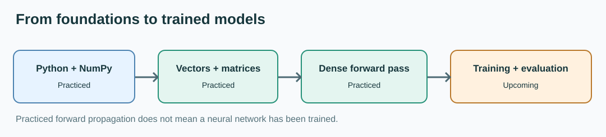

# Roadmap: ML Engineer Foundations to Practical Projects

This is a learning sequence, not a fixed completion guarantee. Do not mark a module as mastered because a formula was calculated once.

## Phase 1 — Programming and numeric foundations (in progress)

- Python core and DSA practice.
- NumPy arrays, shapes, slicing, matrix operations and broadcasting.
- Vectors, matrix multiplication, transpose, angles.
- Refresh calculus and probability when needed.

**Evidence:** [Python-cheat_sheet](https://github.com/Vaibh37/Python-cheat_sheet) and [ML-MATH](https://github.com/Vaibh37/ML-MATH).

## Phase 2 — First predictive models (in progress)

- Input features, targets, predictions and datasets.
- **Practiced:** linear regression predictions `y_pred = w * x + b`, squared error, NumPy MSE, manual comparison of losses at different weights.
- **Practiced:** introductory differentiation (power, chain and partial derivative rules; loss notation).
- **Introduced:** gradient descent direction and parameter-update equation.
- **Next:** derive gradients for full-dataset MSE, implement gradient descent for both weight and bias, then train a simple model and inspect its failure cases.
- pandas and scikit-learn workflows, data splits and evaluation.

## Phase 3 — Neural network training (upcoming)

- Dense layers and activation functions (forward pass practiced).
- Loss functions for regression and classification.
- Power rule, chain rule and partial derivatives (practiced on small examples); backpropagation (upcoming).
- Learnable weights and biases, optimizer steps and a training loop.
- PyTorch implementation and a documented end-to-end experiment.

**Evidence so far:** [Neural-Network](https://github.com/Vaibh37/Neural-Network) contains forward-pass calculations, *not* a trained classifier.

## Phase 4 — Deep learning and modern ML (future)

- pandas, scikit-learn, data preparation, train/validation/test split, baselines, regression/classification and metrics.
- PyTorch, automatic differentiation, training loops, CNN/RNN context where useful, and deep learning practice.
- Transformer foundations, tokenization, attention, embeddings and LLM internals.

## Phase 5 — LLM engineering and applied AI (future)

- Embeddings, vector stores, retrieval, RAG, reranking, evaluation and grounded generation.
- **LangChain and LangGraph**, tool use, state, agentic workflows, reliability, and evaluation.
- Supervised fine-tuning (SFT) and later preference optimization (DPO), when foundations are ready.
- Inference and serving, experiment tracking, deployment and MLOps.

## Immediate milestone: first from-scratch neural network

**Target: 20 October 2026.** Implement and train a NumPy **2-input → 3-hidden → 1-output** network on XOR. Required: complete forward pass, loss, manual backpropagation, weight/bias updates, verified predictions for all four inputs, editable Excalidraw sources and PNG/SVG exports, and a grounded technical Medium article. These are **planned**, not already delivered. See the [Neural-Network notes](https://github.com/Vaibh37/Neural-Network).

**Long-term employment-preparation target: 31 May 2027.** Alongside ML projects, practice Python DSA/LeetCode, deployment and portfolio documentation. No unrelated backend or Rust detours in this active study plan.

## Milestone requirements before publishing a model project

A project should include the dataset source, preprocessing, reproducible run commands, metric definitions, baseline, results, limitations, and what was actually implemented. Avoid calling inference-only code a trained model.
